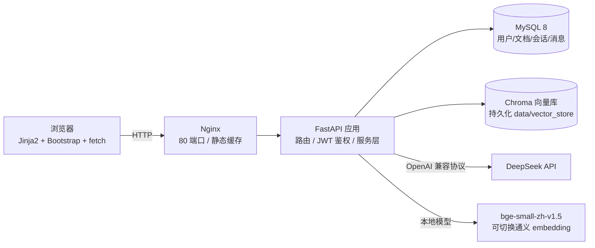

# 企业客服知识库系统

> 面向中小企业的智能客服知识库系统：管理员上传 PDF / Word / TXT / Markdown 文档自动构建向量索引，员工与客户基于知识库进行多轮智能问答，回答附带参考来源、不编造内容。

- 线上地址：`http://<服务器公网IP>`（部署后填写）
- GitHub：`https://github.com/Sizeyu666/customer-service-kb`

## 功能特性

- **用户与权限**：注册 / 登录 / 退出，JWT 鉴权，普通用户与管理员两种角色；首个注册账号自动成为管理员；越权访问返回 403。
- **知识库管理**（管理员）：多文件上传 PDF / DOCX / TXT / MD（单文件 ≤ 20MB），自动解析、中文切分、写入 Chroma 向量库；支持删除文档（同步清理数据库、磁盘、向量三处）与一键重建索引；失败文件不入库并给出中文原因。
- **智能客服问答**：基于 RAG 的多轮问答（带历史指代改写），回答末尾标注参考来源文件名；知识库无依据时返回固定话术，防止幻觉；回答支持点赞 / 点踩。
- **对话历史**：会话与消息按用户隔离，支持查看、关键字搜索、删除（级联删除消息）。
- **管理后台**（管理员）：用户列表与角色调整（保留最后一名管理员）、数据看板（用户 / 文档 / 会话 / 消息数）。
- **工程化**：统一响应格式与全局中文异常处理、Swagger 接口文档（`/docs`）、pytest 基础测试、Docker Compose 一键部署、数据卷持久化。

## 技术栈

| 层 | 技术 |
|---|---|
| 后端框架 | FastAPI + Uvicorn |
| ORM / 校验 | SQLAlchemy 2.0 + Pydantic v2（pydantic-settings 管理配置） |
| 数据库 | 开发 SQLite；生产 MySQL 8（docker-compose） |
| 鉴权 | bcrypt 密码哈希 + PyJWT |
| 前端 | Jinja2 + Bootstrap 5（CDN）+ 原生 fetch，无 Node 构建链 |
| RAG | LangChain 1.x（LCEL，兼容层 langchain-classic）+ langchain-chroma + DeepSeek |
| 向量化 | 默认本地 bge-small-zh-v1.5（离线）；可选通义 text-embedding-v3 |
| 部署 | Docker + docker-compose + Nginx（Ubuntu 22.04） |

## 系统架构



## 目录结构

```
customer-service-kb/
├── app/
│   ├── main.py                # 应用入口、路由注册、统一异常处理
│   ├── config.py              # 配置（pydantic-settings 读取 .env）
│   ├── database.py            # engine / SessionLocal / get_db
│   ├── models.py              # SQLAlchemy 模型
│   ├── schemas.py             # Pydantic 模型（统一响应包装）
│   ├── security.py            # bcrypt 哈希、JWT 生成/校验
│   ├── deps.py                # get_current_user / require_admin
│   ├── routers/               # pages / auth / chat / documents / admin
│   ├── services/              # rag_service（RAG 单例）、document_service
│   ├── templates/             # 7 个页面模板
│   └── static/                # css/style.css + js（auth/chat/…）
├── data/                      # uploads / vector_store / samples（gitignore）
├── tests/                     # pytest 基础测试
├── docs/产品说明.md            # 面向非技术读者的产品文档
├── deploy/deploy.sh           # 云服务器部署脚本
├── Dockerfile / docker-compose.yml / docker-compose.sqlite.yml / nginx.conf
└── requirements.txt / .env.example
```

## 本地运行（SQLite 模式）

```bash
# 1. Python 3.11 虚拟环境
python -m venv .venv
.venv\Scripts\activate            # Windows；Linux/Mac 用 source .venv/bin/activate

# 2. 安装依赖（本地 embedding 需要额外安装 torch / sentence-transformers）
pip install -r requirements.txt
pip install -r requirements-local-embed.txt

# 3. 配置 .env：复制 .env.example，填写 DEEPSEEK_API_KEY
cp .env.example .env

# 4. 启动
uvicorn app.main:app --reload
```

- 访问 `http://127.0.0.1:8000`：首个注册账号自动成为管理员；
- 接口文档：`http://127.0.0.1:8000/docs`；
- 本地 bge 模型默认从 HuggingFace 缓存读取，已设置 `HF_ENDPOINT=https://hf-mirror.com` 镜像，首次使用会缓存到本地。

## Docker 运行

**完整版（MySQL + Nginx，推荐生产）：**

```bash
cp .env.example .env   # 修改 SECRET_KEY / DEEPSEEK_API_KEY / MYSQL_PASSWORD
docker compose up -d --build
# 访问 http://localhost/
```

**轻量版（2G 内存小机器，SQLite 单容器）：**

```bash
docker compose -f docker-compose.sqlite.yml up -d --build
# 访问 http://localhost:8000/
```

数据持久化：上传文件与向量库挂载在 `./data`，MySQL 数据在 named volume `mysql_data`，重启容器不丢失。

## 云服务器部署（Ubuntu 22.04）

1. 云控制台：安全组放行 **80** 端口（如需 HTTPS 再放行 443）；MySQL 端口**不要**对外开放。
2. 安装 Docker 与 compose 插件（或直接使用脚本自动安装）：

   ```bash
   git clone https://github.com/Sizeyu666/customer-service-kb.git /opt/customer-service-kb
   cd /opt/customer-service-kb
   sudo bash deploy/deploy.sh
   ```

3. 脚本会自动生成 `.env`（`SECRET_KEY` 用 `openssl rand -hex 32` 生成），需手动补 `DEEPSEEK_API_KEY` 与 `MYSQL_PASSWORD`。
4. 常用命令：

   ```bash
   docker compose logs -f app                      # 日志
   docker compose down                             # 停止
   git pull && docker compose up -d --build        # 更新发布
   ```

安全提示：正式环境请修改 `SECRET_KEY` 与数据库密码；`/docs` 为作品集演示保留，生产环境可在 `main.py` 中将 `docs_url` 置空关闭。

## API 文档

启动后访问 `/docs`（Swagger），全部接口带中文 summary 与参数说明。约定：

- 成功响应：`{"code": 0, "message": "成功", "data": ...}`
- 异常响应：`{"code": <HTTP 状态码>, "message": "中文提示", "data": null}`
- 鉴权：请求头 `Authorization: Bearer <token>`

## 默认账号

无预置账号。**首个注册的账号自动成为管理员**，演示时可先注册 `admin`，再在知识库管理页上传 `data/samples` 下的两份示例文档。

## 技术要点

- **JWT 鉴权流程**：登录签发含 `sub/role/exp` 的 token → 前端存 localStorage → `authFetch` 统一带 `Authorization` 头 → 401 自动清理并跳登录页；权限以数据库中角色为准（token 仅做身份识别）。
- **向量按 document_id 增删**：每个文本块 metadata 写入 `document_id/filename`，删除时 `collection.get(where={"document_id": id})` 后按 id 精确删除，保证数据库、磁盘、向量三处一致。
- **RAG 防幻觉**：system prompt 强制只依据知识片段回答，检索不到依据回复固定话术；回答末尾由服务端（而非模型）附加去重后的来源文件名。
- **多轮改写**：`create_history_aware_retriever` 携带最近 6 轮历史把追问改写成独立问题再检索。
- **数据隔离**：所有会话/消息接口按 `user_id` 过滤，跨用户访问返回 403；管理员也不可见他人会话内容。
- **单例与懒加载**：RAG 服务全局单例，向量库、embedding、问答链首次使用时才初始化，空库判断只读 Chroma 计数、不加载模型。
- **级联删除**：会话删除级联消息与反馈；文档删除同步清理三处存储。

## FAQ

- **启动后问答报「未配置大模型密钥」**：在 `.env` 填写 `DEEPSEEK_API_KEY` 后重启。
- **上传成功但状态为失败**：查看文档列表中的失败原因；扫描版 PDF 无法提取文本，请换用可复制文本的文件。
- **首次问答很慢**：本地 bge 模型首次加载需要十几秒，之后常驻内存。
- **Windows 下 pip 安装报错**：`pysqlite3-binary` 仅 Linux 生效（已做平台标记），可忽略。
- **2G 内存服务器能跑吗**：可以，使用 `docker-compose.sqlite.yml` 轻量版；完整版 MySQL 建议至少 4G。

## 免责声明

本项目为个人学习与演示用途的工程化作品。示例文档内容为虚构数据；生产使用前请自行完成安全加固（密钥轮换、HTTPS、访问审计等）并评估问答准确性。模型输出仅供参考，重要业务决策请以人工客服为准。
